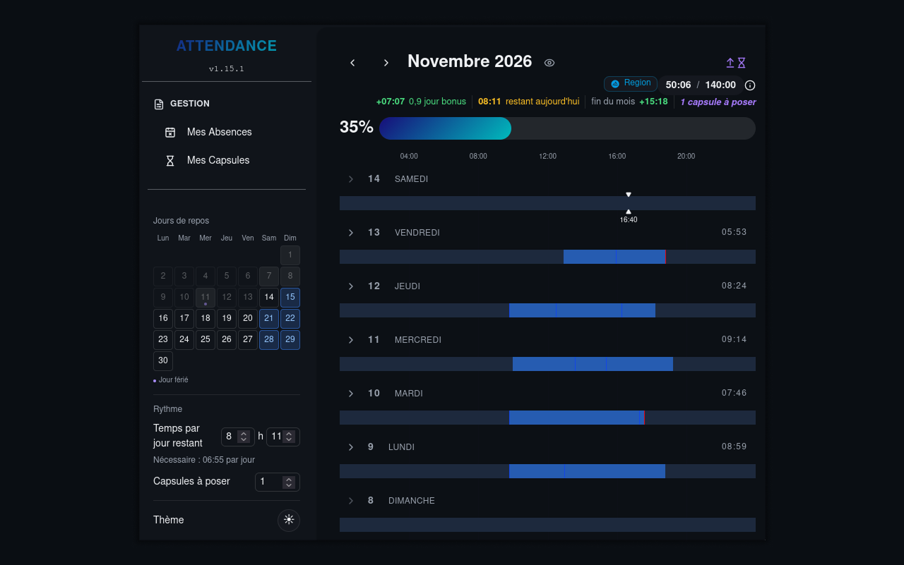

# Improved 42 Attendance

[](https://github.com/parad0xe/improved-attendance/releases/latest)
[](LICENSE)
[](https://chromewebstore.google.com/detail/lbifhclehfgdpjdkpfpjilimhnnedain)

Improves the [42 Lyon attendance page](https://attendance.42lyon.fr/me): plan your days off, time per day and capsules for the month, see the time needed each day to reach the goal, and follow your progress toward it, today and by the end of the month



## Features

### Gap

- Shows your bonus or missing time, in hours and in days, compared with the time to have logged by today to reach the goal of the month with your plan
- While your planned time of today is in progress, shows the time remaining today
- Shows your bonus or missing time at the end of the month if you follow your plan
- In the current month, shows the capsules you still plan to use
- Shows the time expected by today on the progress bar
- Updates by itself when your logged time changes, without reloading the page

### Settings

A block in the sidebar holds:

- a calendar to choose your days off, with weekends, public holidays and campus closures selected by default
- the time you plan for each remaining day, in hours and minutes, 7:00 by default
- the time needed on each planned day, from today, to reach the goal of the month
- in the current month, the capsules you plan to use, each one lowering the goal of the month by 7 hours
- a switch between the light and dark themes

Your days off, planned time and capsules are saved for each month, and your theme is remembered. A capsule used on the site is removed from the planned ones

### Language

The texts follow the language of the site, in French or English

## Installation

Install the extension from the store of your browser:

- Firefox 128 or later: Firefox Add-ons, link to come
- Chrome 111 or later: [Chrome Web Store](https://chromewebstore.google.com/detail/lbifhclehfgdpjdkpfpjilimhnnedain)

Until it is published on Firefox Add-ons, load it in Firefox from the source, see [Development](#development)

## Updates

Your browser updates the extension by itself

## Moving from the userscript

The extension replaces the Tampermonkey userscript

1. Remove the userscript from Tampermonkey, otherwise the gap and the settings show twice
2. Install the extension
3. Choose your days off, planned time, capsules and theme again, as the settings of the userscript are not kept

## Development

Requires Node.js 20 or later

```sh
npm ci
```

| Command | Does |
|---|---|
| `npm run build` | bundles `src/` into `dist/content.js` |
| `npm run dev` | rebuilds `dist/content.js` on each change |
| `npm run typecheck` | checks the types |
| `npm run lint` | builds, then checks the extension with web-ext |
| `npm run firefox` | opens Firefox with the extension, reloaded on each build |
| `npm run android` | opens Firefox for Android with the extension, reloaded on each build, see [Testing on Firefox for Android](#testing-on-firefox-for-android) |
| `npm run package` | builds, then creates the zip for the stores in `web-ext-artifacts/` |

To load the extension without a store, after `npm run build`:

- Chrome: open `chrome://extensions`, turn on **Developer mode**, click **Load unpacked** and choose the folder of the repository
- Firefox: open `about:debugging#/runtime/this-firefox`, click **Load Temporary Add-on…** and choose `manifest.json`

### Testing on Firefox for Android

1. On the phone, turn on **USB debugging** in the developer options of Android, and **Remote debugging via USB** in the settings of Firefox
2. On the computer, install `adb`, connect the phone by USB, then find its id with `adb devices`
3. Run the extension on the phone, with `org.mozilla.firefox_beta` or `org.mozilla.fenix` instead of `org.mozilla.firefox` for Firefox Beta or Nightly:

```sh
npm run build
npm run android -- --android-device=<id> --firefox-apk=org.mozilla.firefox
```

The extension stays installed while the command runs. To see the console of the phone, open `about:debugging` in Firefox on the computer, connect to the phone and inspect its tab

## Building from source

The extension published in the stores is built from this repository, with Node.js 20 or later:

```sh
npm ci
npm run build
```

The build creates `dist/content.js`, the only generated file, which `manifest.json` loads on the attendance page
